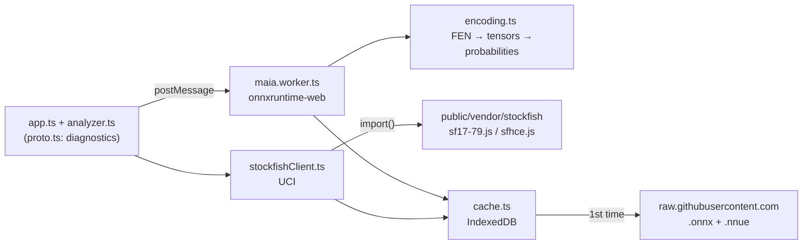

<!-- Generated by scripts/export-docs.mjs from the author's private notes (app.md). Do not edit by hand. -->

> Code references: local files in this folder, which is the git repository [jlcuadros/jquads](https://github.com/jlcuadros/jquads), branch `main` (links are relative to this folder). Logic ported from [CSSLab/maia-platform-frontend](https://github.com/CSSLab/maia-platform-frontend) at commit `a6e52f5c811ee18863cb2f0e81f2433a5b9905de` (GPL-3.0).

| Field            | Value |
| ---------------- | ----- |
| **Reported**     | 2026-10-24, part of the author's project notes |
| **Investigated** | 2026-10-24 |
| **Status**       | ✅ **Closed** (2026-10-25): https://jquads.pages.dev · code at https://github.com/jlcuadros/jquads (AGPL-3.0) · credits and licences reviewed. Optional ideas: Next steps |
| **Owner**        | José Luis Cuadros |
| **Environment**  | Node 26.12.1 + npm 11.20.0 (Homebrew, `brew install node`), Vite 6.4.5, TypeScript 5.9.3, wrangler 4.152.0; macOS 26.6.2 |
| **related**      | the author's project notes · app scripts |

## Abstract
The web app's code: **the app** (`index.html` + `src/app.ts`: board, Maia + Stockfish analysis panel, colours, threats, explanatory text, position editor, settings) and the **diagnostics page of prototype 0** (`proto.html`, engine times). It's published at https://jquads.pages.dev and its source code on GitHub.

## Summary
- **Maia-3** runs in a *Web Worker* with `onnxruntime-web` (WASM). The model (45.7 MB) is downloaded once from GitHub and stored in IndexedDB.
- **Stockfish** comes from `lila-stockfish-web` (Lichess's builds), in two variants: SF17 NNUE (+78 MB of nets, cached) and classic SF (no nets).
- Both need the page to be *cross-origin isolated* (COOP/COEP headers) to use threads (`SharedArrayBuffer`).



## Scope
- In: the full app (interface designed with José over 4 iterations + position editor), engine loading, tests, publishing (Cloudflare Pages) and source code (GitHub).
- Also in (2026-10-25): PGN export, endgame tables, 7 languages, Lichess games, credits and licence texts.
- Out: "Moves by Rating" chart (optional future idea, see the author's project notes › Next steps).

## Takeaways
- Maia gives **the same probabilities** in WebKit and Chromium → the ported encoding is deterministic and consistent → the author's project notes › Investigation 2 — Prototype 0.
- **Vite's 304 trap**: the local server dropped the COOP/COEP headers on 304 responses and WebKit blocked Stockfish's threads. Fixed with a plugin in `vite.config.ts`.

## related structure
| Path | What it stores and why |
| ---- | ---------------------- |
| [package.json](../package.json) | Exact dependencies (`--save-exact`) and npm commands |
| [index.html](../index.html) | **The app**. At the end of the page **only** the link "Ver créditos: ⚙ > Créditos y licencias" (opens ⚙ with the credits unfolded); the author (José Luis Cuadros, Lichess/LinkedIn contact) and the credits for Maia Chess and the rest are **only** in ⚙ → "Créditos y licencias" → the author's project notes › 3.7 Credits: author and Maia Chess (2026-10-25). Since 2026-10-28 ⚙ → Motor has **"Candidatas h-eval"** (`#hevalCandidates`) and ⚙ → Interfaz **"Columna «h-eval» en Maia"** (`#showHevalCol`); help «h-eval» (`help.heval.html`). Since 2026-10-28 ⚙ has three parts: always visible (language with flags, usernames, Maia's Elo), **▸ Motor** and **▸ Interfaz** (`<details class="settings-group">`). Since 2026-10-26: **📋** first in the info line opens the position/game panel (FEN, editor, load FEN, new game, export PGN), and ⚙ no longer contains them. Structure (since iteration 2): info line (numbers + ⇅ ↗Li ⚙), ⚙ panel (Elo, depths, hash, SF version, moves per engine, threats mode bar/moves/off, FEN, help "Cómo se lee la pantalla"), board, 2 untitled bars, navigation, move list, columns, text |
| [src/app.ts](../src/app.ts) | Main logic: board (chessground) with legal moves and arrows, navigation, settings `AppSettings` (Elo, depth, threatDepth, lines, threatsMode, hashMb, variant, **notation**, **evalBar**, **tablebase**, **lang**, **lichessUser**, **chesscomUser**, **meterMode** (top bar: both / bar / moves / off, default bar), **deltaCol**, **maiaCol**, **hevalCol** (middle columns on/off), **hevalCandidates** (h-eval: number of candidates, 0 / 5 / 10 / 15 / 20, **default 0 = off**; settings version 4 migrates the first default 10 to 0), **book** (opening book on/off), **sfThreads** (Stockfish threads: 1 … cores, max 8, default min(4, cores); `setoption Threads` live), **theme** (system / light / dark, applied by `window.applyTheme` in `index.html`), **sfNps** (last speed test, ⚙ → Motor → Medir: `StockfishClient.benchmark()`, 1 s of `go movetime`; also run automatically the first time and when the threads change), **depth / threatDepth** = a number or `'auto'` (default; `stockfish/autoDepth.ts`: from `sfNps`, 15 at 1.83 M nodes/s, 10 at 0.4 M, threats − 3, min 10 / 9; settings version 3 migrates the old 18 / 12 to auto); saved in localStorage with format version `SETTINGS_VERSION`; migrations: old `threats` checkbox → `threatsMode`, and default 'bar' → 'moves' in version 2), orange **threat** arrow (extra `threat` brush in chessground), loading the engines with progress, launching the `Analyzer` on each position change. Changing the hash → `stockfish.configure()`; changing the version → reload |
| [src/ui/render.ts](../src/ui/render.ts) | HTML builders for each part of the panel (numbers, bars, move list, Maia/SF columns, text). Since iteration 6 (opening book): `renderBookLine` ("📖 Libro: e4 52% · d4 31% … — N partidas" at the start of the text) and a 📖 after book moves in both columns. Since 2026-10-26 the text has paragraphs, each with a first icon (📖 book, ♙ White, ♟ Black): book line, engines' text about the position (`.side-text`), then `renderPreviousMove` (summary of the previous move, from `analysis/previousMove.ts`). Δ eval rules with mates ("↓M+3", "↓M−6", "⇵−M6", "⇵+M?"): `deltaEval` in `classify.ts`, see the task note 3.13. Since iteration 6: Maia column = move · "Δ eval" (`↓x.x`, optional) · **"h-eval"** (optional, since 2026-10-28; empty for moves that aren't h-eval candidates) · prob without decimals; `bombMark` puts **💣** after the best h-eval move in both columns, and if Maia's list doesn't have that move it **replaces the least likely one** (the list keeps its length); SF column = move · Maia % (optional) · eval with one decimal; headers "SF" / "TB". Clickable moves carry `data-move` / `data-node`. Bar legend: Maia's moves in order of probability (≥ 1 %, max. 10; the CSS shows only one line) |
| [src/style.css](../src/style.css) | Styles with automatic light/dark theme; **nothing may overflow sideways** (chessground's file letters moved inside the board, `overflow-x` clipped: see the author's project notes › 3.10 Bug: everything shifted left after a move (2026-10-25)); one column on mobile, two from 900 px. Colour-code markers on every move (`.move-chip::before`). **Move markers (2026-10-26):** one CSS for the chips' `::before` and the strip / 📜 `.mark` — colour from `--chip` (quality), shape class `.shape-circle` (default) / `.shape-square` / `.shape-triangle` (CSS border trick + drop-shadow) = how likely the move is (● ≥ 25 %, ■ 10–25 %, ▲ < 10 %; thresholds in `analysis/likelihood.ts`). **Columns:** `.cols` 1fr : 1fr; **only with the h-eval column shown** (`.cols.with-heval`, toggled on `#cols` by `renderPanel()` in `app.ts`, 2026-10-29) 1.2fr : 0.8fr, the Maia move cell without wrapping (move + 📖 💣 on one line) and, at the end of the file, a `@media (max-width: 359px)` rule with smaller column text for 320 px screens (it must stay last to override the base rules); `.heval-mark` |
| [proto.html](../proto.html) | Prototype 0 diagnostics page (engines only, times, "Copy results" button); moved here from `index.html` on 2026-10-24 |
| [vite.config.ts](../vite.config.ts) | Dev server; `crossOriginIsolation()` plugin that sets COOP/COEP on **every** response; `allowedHosts` for cloudflared tunnels |
| [tsconfig.json](../tsconfig.json) | TypeScript config (strict) |
| [src/proto.ts](../src/proto.ts) | Prototype 0 logic (`proto.html`): diagnostics, buttons, `?auto=1` mode, results in `window.__proto` |
| [src/game/notation.ts](../src/game/notation.ts) | **Pure**: `formatSan` → figurines (♘ White / ♞ Black) or letters |
| [src/game/pgn.ts](../src/game/pgn.ts) | **Pure**: `movetextTokens(tree)` (moves, comments, variations — shared by the PGN writer and the 📜 view); `gamePgn(tree, date, headers)` → PGN of the whole game with variations in parentheses, Seven Tag Roster + extra tags (editable, ⚙ → Exportar PGN and 📂 → 💾 Guardar), SetUp/FEN if the start isn't the initial position; `parsePgnHeaders`, `defaultHeaders`; `treeFromPgn` = our own movetext reader **with variations and comments** (chess.js drops them; clock/eval commands removed) |
| `public/icons/`, [public/manifest.webmanifest](../public/manifest.webmanifest) | José's icon (180/192/512 px + SVG) and manifest for the home screen: name **jquads**, `display: standalone` |
| [src/game/position.ts](../src/game/position.ts) | **Pure**: position editor logic: `possibleCastling` (king and rook on their squares), `buildFen` (board + side to move + castling → full FEN) and `validatePosition` (kings, pawns, check on the side not to move; error messages in Spanish) |
| [src/ui/editor.ts](../src/ui/editor.ts) | **Full-screen position editor** (⚙ → "Introducir posición"): chessground with `movable.free`, palettes (pieces, ✋ move, 🗑 erase; tap or drag), side to move, castling, Posición inicial / Vaciar / Girar / Cancelar / Analizar. Calls the app with the validated FEN |
| [src/game/tree.ts](../src/game/tree.ts) | **Pure**: `GameTree` (game with variations: play, navigate, numbering, line to display) and `nullMoveFen()` (passes the turn to compute threats; `null` if in check) |
| `src/**/*.test.ts` | Unit tests (`npm test`, vitest, **156**): [book/openingNames.test.ts](../src/book/openingNames.test.ts) (opening names: key, transpositions, PGN), [games/localDbs.test.ts](../src/games/localDbs.test.ts) (PGN splitting, names, dates, ids), [book/polyglot.test.ts](../src/book/polyglot.test.ts) (reference keys of the Polyglot spec, castling, lookup), [games/favorites.test.ts](../src/games/favorites.test.ts), [games.test.ts](../src/lichess/games.test.ts), [chesscom/games.test.ts](../src/chesscom/games.test.ts), [i18n.test.ts](../src/i18n/i18n.test.ts), [tablebase.test.ts](../src/analysis/tablebase.test.ts), [notation-pgn.test.ts](../src/game/notation-pgn.test.ts), [position.test.ts](../src/game/position.test.ts), [tree.test.ts](../src/game/tree.test.ts), [classify.test.ts](../src/analysis/classify.test.ts), [describe.test.ts](../src/analysis/describe.test.ts), [encoding.test.ts](../src/maia/encoding.test.ts), [analyzer.test.ts](../src/analysis/analyzer.test.ts) (`shownMaiaMoves`), [heval.test.ts](../src/analysis/heval.test.ts) (José's example +0.4 / +1.6 and 💣, Black to move, mate in 1, 90 % / 8 replies, the formula) |
| [src/games/common.ts](../src/games/common.ts) | **Shared by both game sites**: `GameSummary` (with `site`), `GamesQuery`, `GamesPage`, `GamesError`, user colour/result, score and time-control text, dates, `serialQueue` (one request at a time per site), `fetchOrThrow` (HTTP errors → `GamesError`) |
| [src/lichess/games.ts](../src/lichess/games.ts) | **Lichess games**: API URL with filters (speed, dates), NDJSON parsing → `GameSummary`, `fetchLichessGames` |
| [src/chesscom/games.ts](../src/chesscom/games.ts) | **Chess.com games** (PubAPI): monthly archives newest first, speed/date filters on our side (no "classical"; "daily" = correspondence), past months cached for the session, ≤ 6 downloads per page, game → `GameSummary` |
| [src/games/favorites.ts](../src/games/favorites.ts) | Favourite games on the device (localStorage `favoriteGames`), every site in one list; `saveFavorite` (add/update a saved game) and **the favourites as one PGN file** in `favoritesPgn`, rewritten on every change |
| [src/games/localDbs.ts](../src/games/localDbs.ts) | **📁 Local databases** (iteration 10): PGN files of the device (read-only, the last 4 kept) and databases made in the app (writable); list in localStorage `localDbs`, games in IndexedDB `jquads-local-dbs`; pure helpers `splitPgnGames`, `shortName`, `pgnDateMs`, `dbSummaries`, `gameRef` (ids `ldb-…#n`) |
| [src/lib/download.ts](../src/lib/download.ts) | `shareFile`: hands a file to the user — iPhone share sheet, or a normal download (⬇ Descargar PGN) |
| [src/ui/gamesPanel.ts](../src/ui/gamesPanel.ts) | **📂 panel**: **💾 Guardar** view (PGN header form → favourite; `ownerName`), **⬇ Descargar PGN** in the favourites, site selector **Lichess / Chess.com** (`SOURCES` table: fetch function + speed chips per site), user per site; **💾 Guardar** at the top left (destination: ⭐ or a local database made here); one row **Lichess | Chess.com | ⭐ Favoritas | 📁 Local** (⭐ and 📁 icon-only below 420 px; ⭐ and 📁 hide the username and the filters); 📁 Local (open a PGN, ＋ Nueva, 🗑, database buttons); `picked` = the list the game came from (📜 ⏪ ⏩ 📂), speed chips and dates, list of 20 + "Cargar más", ☆/⭐; opening a game → `onPick` (app: `treeFromPgn` + board towards the user) |
| [src/i18n/](../src/i18n/i18n.ts) | **Translations**: `i18n.ts` (t(), setLang, detectLang, applyStaticTranslations, LANGUAGES), `es.ts` (reference) and `en/fr/it/ru/de/pt.ts` with the same keys (checked by TypeScript and `i18n.test.ts`) |
| [src/analysis/tablebase.ts](../src/analysis/tablebase.ts) | **Lichess endgame tables** (≤ 7 pieces, no castling): pure translation of the API (category → result, dtm in plies → moves, Stockfish-style `Score`, labels in White's point of view "+M12" / "−M20" / "+M?" via `tbLabel`) and `TablebaseClient` (cache per position, one request at a time, 5 s timeout, 60 s pause after 429) |
| [src/analysis/describe.ts](../src/analysis/describe.ts) | **Pure**: explanatory text in Spanish as segments (text / coloured, clickable move). Rules: evaluation in words (±0.35 / 1.5 / 3), good moves (≤ 3), how findable they are for the Elo (Maia's mass on good moves: ≥ 70 % easy, ≥ 30 % "not obvious", < 30 % hard), and "Cuidado con…" for moves Maia gives ≥ 10 % that are ok/blunder |
| [src/analysis/analyzer.ts](../src/analysis/analyzer.ts) | Coordinator per position: Maia → SF MultiPV 4 (progressive) → **h-eval** of the candidates (the SF and Maia columns' moves, filled up to N with SF at depth 7) (`heval.ts`, main position only) → SF `searchmoves` over **every move Maia shows** and the 💣 move (`shownMaiaMoves`: ≥ 1 %, max. 6 = the bar line; depth ≤ 14) → colours + Blunder Meter → **threats** (same thing on `nullMoveFen`, at `threatDepth`). Cancels if the position changes; cache per FEN+Elo+depths. The colour code isn't applied below depth 12 |
| [src/analysis/classify.ts](../src/analysis/classify.ts) | **Pure functions**: cp → win %, classifying moves (good / ok / blunder) with colours, Blunder Meter, score format |
| [src/maia/encoding.ts](../src/maia/encoding.ts) | **Pure functions** ported from maiachess: mirroring if black to move, board → `tokens [64,12]`, legal moves → indices, logits → probabilities and win % |
| [src/maia/all_moves_maia3.json](../src/maia/all_moves_maia3.json) | Dictionary of the model's 4352 moves (UCI → index), copied from maiachess |
| [src/maia/maia.worker.ts](../src/maia/maia.worker.ts) | Worker: downloads/caches the model, creates the ONNX session, runs inference on a batch of `{fen, elo}` items (several positions and Elos per batch, used by h-eval) |
| [src/maia/maiaClient.ts](../src/maia/maiaClient.ts) | Promise wrapper around the worker (`predict(fen, elos)`, `predictMany(items)`); pinned model URL |
| [src/stockfish/stockfishClient.ts](../src/stockfish/stockfishClient.ts) | Loads Stockfish (sf17/sfhce), NNUE, UCI handshake. `analyse()` with MultiPV and optional `searchmoves`; searches are **queued** one after another and `stop()` interrupts the current one (needed when changing position). `configure()` sends `setoption` once the engine is idle (hash). `parseInfo()` converts scores to white's point of view |
| [src/lib/cache.ts](../src/lib/cache.ts) | Download-once IndexedDB cache with progress; shared by Maia and Stockfish (DRY) |
| [src/lib/idb.ts](../src/lib/idb.ts) | `kvStore(db, store)`: minimal IndexedDB key-value store (get / put / delete / clear), used by `cache.ts` and `localDbs.ts` (iteration 10) |
| [public/_headers](../public/_headers) | COOP/COEP headers for Cloudflare Pages (production: https://jquads.pages.dev) |
| `public/vendor/` | Engine files copied from `node_modules` by `copy-vendor` (generated, not edited by hand) |
| `public/book/lichess-2300-slow-v1.bin` / `.json` | **Opening book** (iteration 6): Polyglot, 5.49 MB, Lichess games with both players 2300+, rapid and classical; the JSON says how it was built. Made with `scripts/book/` → book |
| [src/stockfish/autoDepth.ts](../src/stockfish/autoDepth.ts) | **Pure**: "Auto" depth from the measured speed (José's reference points: iPhone 15 1.83 M nodes/s → 15, 0.4 M → 10; never below 10; threats − 3, ≥ 9) |
| [src/analysis/heval.ts](../src/analysis/heval.ts) | **Pure** (engines passed in): **h-eval** — candidates = `shown` (the SF and Maia columns' moves) filled up to N with SF at depth 7 (`HEVAL_DEPTH`; no search if `shown` already has N) → opponent replies (Maia, selected Elo, ≥ 90 %, max 8) → valued by Maia 2600 → weighted mean → cp = ln(p/(1−p))/0.00368208; best = 💣 (`hEval`, `likelyReplies`, `scoreToCp`) |
| [src/analysis/likelihood.ts](../src/analysis/likelihood.ts) | **Icon code** used everywhere: shape = Maia's probability of the move — ● ≥ 25 %, ■ 10–25 %, ▲ < 10 % (`shapeOf`, `probOf`; the only place with these thresholds) |
| [src/analysis/moveMarks.ts](../src/analysis/moveMarks.ts) | **Pure**: mark of a move in the strip / game view — colour = quality (`judgePreviousMove`), shape = how likely the played move was (`likelihood.ts`) |
| [src/ui/choice.ts](../src/ui/choice.ts) | Small choice dialog (variations: new / overwrite / cancel; ▶ with several continuations) |
| [src/ui/gameView.ts](../src/ui/gameView.ts) | 📜 full-screen view of the whole game (variations, comments, marks; tap a move to go there); bar ⏪ previous game · 📂 its list · 💾 headers · ⏩ next game (iteration 10) |
| [src/analysis/previousMove.ts](../src/analysis/previousMove.ts) | **Pure**: summary of the move that led to the position (best / good / inaccuracy / mistake / missed or allowed mate, "típico"/"raro" for the rating from Maia ≥ 10 % / < 2 %), from the previous position's cached analysis (`Analyzer.cached`) |
| [src/book/polyglot.ts](../src/book/polyglot.ts) | **Pure**: Polyglot key of a FEN (BigInt, with `polyglotRandom.ts`), move decoding (castling stored as king-takes-rook), `PolyglotBook.lookup(fen)` by binary search → moves with games and share |
| [src/book/openingNames.ts](../src/book/openingNames.ts) | **Opening names** (iteration 11; no lookups from move 22, `LAST_MOVE_LOOKED_UP`, `moveNumberOf`): `OpeningNames` — `exact(fen)`, `at(node)` (own name or the last named position before), `changeAt(node)` (comment where the name changes), `headers(tree)` ([ECO] + [Opening]); `loadOpenings()` (fetchCached) |
| [src/book/positionKey.ts](../src/book/positionKey.ts) | **Pure, no imports**: position key = FEN pieces/side/castling + en passant only if capturable; shared with `scripts/openings/build-openings.mjs` |
| `public/openings/lichess-openings-712a58b.json` | **Opening names**: key → [ECO, name], 3,865 positions from the Lichess opening list (CC0, commit 712a58b). Made with `scripts/openings/build-openings.mjs` |
| [src/book/openingBook.ts](../src/book/openingBook.ts) | `BOOK_FILE` (the version is in the name: a new book = new name, so the IndexedDB cache never serves an old one), `loadBook()` via `fetchCached`; loaded after the engines |
| `public/licenses.txt` | **Third-party licences** (components, authors, licences, full texts of AGPL-3.0 / GPL-3.0 / MIT / BSD-2), generated on every build by `scripts/third-party-licenses.mjs`; linked from ⚙ → "Créditos y licencias" → "Textos completos de las licencias". Not committed → the author's project notes › Investigation 9 — Licence review and credits (2026-10-25) |
| [licenses/onnxruntime-LICENSE.txt](../licenses/onnxruntime-LICENSE.txt) | MIT licence of onnxruntime (its npm package has no LICENSE file; copied from github.com/microsoft/onnxruntime) |
| `scripts/` | Helper scripts → scripts |
| `node_modules/`, `dist/` | Generated by npm / the build. Excluded in Obsidian (`.obsidian/app.json` → `userIgnoreFilters`, **with the full path** since 2026-10-25) and from git |
| [README.md](../README.md), [LICENSE](../LICENSE), [.gitignore](../.gitignore) | Public repository: description, AGPL-3.0 licence, what isn't uploaded |
| `docs/` | **Generated** by `scripts/export-docs.mjs` from this note and `scripts.md` (public version, no Obsidian links or personal data). Don't edit by hand. Excluded in Obsidian |

## Facts
- `npm run build` passes (`tsc` strict + Vite) on 2026-10-24.
- Smoke test passes in WebKit and Chromium, sf17 and sfhce (2026-10-24) → the author's project notes › Investigation 2 — Prototype 0.
- Not all subfolders of `src/` have their own `.md`; they are documented in this table (decision: Decision).

## Notes
- **npm commands** (from this folder, `app/`):
  - `npm install`: installs dependencies (first time, or after cleaning).
  - `npm run dev`: dev server at `http://localhost:5173` (also on the local network with `--host`).
  - `npm run build`: copies vendor files, type-checks and builds into `dist/`.
  - `npm run preview`: serves `dist/` at `http://localhost:4173` (what the smoke test uses).
  - `npm run deploy`: publishes to https://jquads.pages.dev (see below).
  - `npm run deploy:preview`: publishes to the **test URL https://preview.jquads.pages.dev** (Cloudflare preview branch `preview`); production is untouched. Used for every change before José says "publica" (2026-10-29).
  - `npm test`: unit tests of the pure functions (vitest, no browser needed).
- **Annotations (✏️, 2026-10-29):** `src/game/annotations.ts` (NAG table and rules, pure), `MoveNode.nags`, `src/game/pgn.ts` (reads `$n` and `e4!?`, writes `$n`), `src/ui/annotate.ts` (panel from the bottom). Phase 2 (2026-10-29): `src/game/drawing.ts` (arrows / squares, `[%cal]` / `[%csl]`, pure), `MoveNode.drawings`, `src/ui/boardDraw.ts` (pointer events on the view-only board while ✏️ is open), drawn in `updateBoard()` → the author's project notes › 3.23 ✏️ Annotations, phase 1: symbols and comment (2026-10-29), the author's project notes › 3.24 ✏️ Annotations, phase 2: arrows and coloured squares (2026-10-29).
- **Automatic symbols (iteration 7, 2026-10-29):** `src/analysis/autoSymbols.ts` (criteria, pure), `displayNags` / `mergedNags` in `game/annotations.ts` (yours over automatic), `autoOf()` in `app.ts` (from the cached analyses + the book), `gamePgn(…, nagsOf)` exports both. Scale for symbol and text: `EVAL_BANDS` (0.35 / 0.90 / 2.00). **Sources:** Lichess's thresholds and mate rules ([Advice.scala](https://github.com/lichess-org/lila/blob/898ad2cdee0aa803d7959d83868efc00097a648b/modules/tree/src/main/Advice.scala#L44-L49), [mates](https://github.com/lichess-org/lila/blob/898ad2cdee0aa803d7959d83868efc00097a648b/modules/tree/src/main/Advice.scala#L98-L106), [liveAnnotate.ts](https://github.com/lichess-org/lila/blob/898ad2cdee0aa803d7959d83868efc00097a648b/ui/analyse/src/liveAnnotate.ts#L22-L32)); Stockfish's scale ([FAQ](https://official-stockfish.github.io/docs/stockfish-wiki/Stockfish-FAQ.html), [WDL_model](https://github.com/official-stockfish/WDL_model)); no standard symbol table ([TalkChess](https://talkchess.com/viewtopic.php?p=489426)). Arrows: settings `arrowSF` / `arrowMaia` / `arrowThreat` → `arrows()`. 📜 players: `pgnSite` / `playerHtml` in `render.ts` → the author's project notes › 3.25 Iteration 7: arrows, automatic symbols, players in 📜 — analysis (2026-10-29).
- **Iteration 8 (2026-10-29):** 📋 `copyFen` next to the FEN; Maia's top number `formatScore({ cp: scoreToCp(p) })` in `renderNumbers`; the bar's `.sf-mark` (blue, at `--white-pos`) and Maia's mark from that evaluation → the author's project notes › 3.26 Iteration 8: copy the FEN, Maia as an evaluation, Stockfish line in the bar (2026-10-29).
- **Lichess / Chess.com links (2026-10-29):** logos in `public/icons/lichess.svg` and `chesscom.svg`, next to the FEN in 📋 → the author's project notes › 3.22 Lichess and Chess.com logos in 📋 instead of ↗Li (2026-10-29).
- **Testing on the iPhone with a temporary tunnel** (no Cloudflare account; `brew install cloudflared`, version 2026.10.3):
  ```bash
  npm run build && npx vite preview --port 4173 --strictPort &   # serves dist/
  cloudflared tunnel --no-autoupdate --url http://localhost:4173  # prints https://<random>.trycloudflare.com
  ```
  Open `https://<random>.trycloudflare.com/?auto=1` in Safari on the iPhone. The URL changes every time and stops working when `cloudflared` is closed. It's public while it's open (anyone with the link could see it).
  `vite.config.ts` allows the `.trycloudflare.com` hosts (`allowedHosts`); without that, Vite responds **403**.
- **Git repository / source code**: `app/` is a git repo → **https://github.com/jlcuadros/jquads** (AGPL-3.0, [LICENSE](../LICENSE), [README.md](../README.md)). `app.md` and `scripts/scripts.md` are **not** published (`.gitignore`): `node scripts/export-docs.mjs` generates their cleaned versions in `docs/`. **Workflow for every change**: `npm test` → `node scripts/export-docs.mjs` → `git add -A` → `git commit` (**no mention of Claude** in the message, see Desired structure) → `git push` → `npm run deploy`. Local identity of the repo: `jlcuadros` + GitHub's private email (noreply). `git push` uses `gh`'s credentials thanks to `gh auth setup-git` (run once on 2026-10-25; without it the push failed with "Authentication failed").
- **Test URL (preview)**: `npm run deploy:preview` → same build, uploaded with `--branch preview` → **https://preview.jquads.pages.dev** (plus a fixed URL per upload, `https://<hash>.jquads.pages.dev`). HTTPS and the same `_headers` (COOP/COEP), so it works on the iPhone exactly like production; Cloudflare adds `x-robots-tag: noindex`. Separate origin → separate model cache (first visit downloads ~125 MB). Unlike the `cloudflared` tunnel above, its URL is fixed and doesn't need the Mac on → the author's project notes › Investigation 14 — Preview URL before publishing (2026-10-29).
- **Repository renamed** (2026-10-29): `maia-stockfish-analysis` → (`chessplosives`, reverted the same day) → **`jquads`**; GitHub redirects the old names. Local remote: `https://github.com/jlcuadros/jquads.git`.
- **Publishing (production)**: `npm run deploy` → builds and uploads `dist/` to Cloudflare Pages, project `jquads` → **https://jquads.pages.dev**. Needs `npx wrangler login` once (Cloudflare account `(private)`). The `public/_headers` file sets COOP/COEP. **Don't use `wrangler deploy`** (that's for Workers) or `--force` (only needed once to create the project) → the author's project notes › Investigation 4 — Publishing on Cloudflare Pages (2026-10-25).
- **Useful URL parameters**: `?auto=1` (does everything by itself), `&sf=sfhce`, `&threads=2`, `&depth=14`, `&fen=...`.
- **npm 11 doesn't run install scripts by default**: `esbuild` and `protobufjs` show a warning ("install scripts not yet covered"). It isn't needed: the build works without them.

## Decision
- **Exact versions** that are known to work with the maiachess files: `onnxruntime-web` 1.23.0, `lila-stockfish-web` 0.0.7 (matches the `nn-1111cefa1111` / `nn-37f18f62d772` nets). Vite 6 (stable) rather than 8.
- **Model and NNUE downloaded from raw.githubusercontent** (pinned commit), not stored in the vault or deployed: they weigh 45.7 + 74.9 + 3.5 MB, and that host sends `Access-Control-Allow-Origin: *` and `Cross-Origin-Resource-Policy: cross-origin`, which is compatible with COEP (checked with `curl -I`).
- **Engine files served from `public/vendor/`** (not bundled by Vite): Emscripten looks for its `.wasm` and launches its threads relative to its own URL.
- **Colour code with Lichess's formula** (`1/(1+e^(−0.00368208·cp))`) instead of maiachess's lookup table: one line, same shape. Same thresholds (5 % / 10 %) and same palettes → [src/analysis/classify.ts](../src/analysis/classify.ts).
- **Evaluating Maia's moves**: Stockfish analyses its N best lines (⚙, default 4) and then, with `searchmoves`, **every move Maia shows** that wasn't among them (≥ 1 %, max. 6, also for the threats; José, 2026-10-25). Result: everything on screen is evaluated and nothing else. Not all legal moves: moves < 1 % aren't shown and would multiply the time.
- **The prototype stays** in `proto.html` as a diagnostics page (useful for measuring other devices).
- **Promotion = always a queen** in v1 (no piece picker). To improve if it's ever needed.
- **Threat arrow in orange** (iteration 3, José's request); before (iteration 1) there was no arrow so as not to clutter the board.
- **"Moves per engine" = Maia rows and Stockfish MultiPV** (same number in both columns). The threats always use MultiPV 3 (only the best move and the colours are needed).
- **Downloads with 4 attempts** (waits of 2, 5 and 10 s, `cache.ts`): during the tests there were network drops of several seconds (2026-10-25).
- **One `.md` per main folder** (`app/`, `scripts/`), not per `src/` subfolder: the `related structure` table above covers them without filling the vault with tiny notes.

## Next steps
1. ✅ Test on the real iPhone: works → the author's project notes › Investigation 2 — Prototype 0.
1b. ✅ **Interface** (2026-10-25): v1 + 4 iterations of José's feedback + position editor + credits → the author's project notes › Investigation 3 — Interface design (GUI). Published → the author's project notes › Investigation 4 — Publishing on Cloudflare Pages (2026-10-25); code → the author's project notes › Investigation 5 — Publishing the source code (2026-10-25).
1c. ✅ PGN export, endgame tables, languages, Lichess games, credits/licences (2026-10-25).
1d. ✅ **Closed (2026-10-25).** Optional ideas (Moves by Rating, what the threats bar measures…) in the author's project notes › Next steps.

### Where we left off (2026-10-24, session paused by José) — *historical, all completed on 2026-10-25*
**Done (compiles, `npm run build` OK; NOT tested yet):**
- `chessground` 9.2.1 and `vitest` 3.2.7 installed (exact versions in `package.json`).
- Prototype moved to `proto.html` + `src/proto.ts`; `smoke-test.mjs` now opens `/proto.html?auto=1`. Vite builds both pages (`build.rollupOptions.input`).
- `index.html` is a **placeholder** ("Interfaz en construcción") with a link to `proto.html`.
- `src/stockfish/stockfishClient.ts`: search queue + `stop()` + `searchmoves` (**untested**: re-run the smoke test).
- `src/analysis/classify.ts`: win %, classification, colours, Blunder Meter (**no tests yet**).

**Pending, in this order:**
1. ✅ (2026-10-25) Unit tests (`vitest`) for `classify.ts` and `encoding.ts`; `npm test` command → **16/16 OK**.
2. ✅ (2026-10-25) `src/game/tree.ts`: move tree with variations + `nullMoveFen()` for threats (with tests).
3. ✅ (2026-10-25) `src/analysis/describe.ts` (with tests, 18/18 in total): explanatory text in Spanish from Maia + Stockfish (deterministic templates inspired by maiachess, the author's project notes › 1.1 Analysis panel).
4. ✅ (2026-10-25, compiles; tested only through the UI) `src/analysis/analyzer.ts`: per position → Maia (selected Elo) + Stockfish MultiPV 4 + `searchmoves` for Maia's candidates → `classifyMoves`; result cache per FEN; `stop()` when the position changes.
5. ✅ (2026-10-25) UI: `src/app.ts` + `index.html` + CSS →  the author's project notes › 3.1 Interface v1: first version (2026-10-25). Original plan: board (chessground, with chessground.base/brown/cburnett CSS from `node_modules/chessground/assets/`), move list, panel (Maia with Elo selector, Stockfish, text, Blunder Meter), arrows (red Maia / blue SF), "Open in Lichess" button (FEN URL with `_`, see task_01_iphone chessable extension › Investigation 1 — URL format). Layout: board on top and panel below on mobile; side by side on desktop.
6. ✅ `ui-test.mjs` OK in WebKit (iPhone 13 emulation); **`smoke-test.mjs` re-run against https://jquads.pages.dev/proto.html on 2026-10-25: OK** (WebKit, sf17 and sfhce, no errors; Maia top Bc4; SF d14 ~0.8 s); José tested it on his iPhone ("it seems to work fine").
7. ✅ Notes updated.

**Processes:** `vite preview` and the `cloudflared` tunnel were **stopped** at the end of the session (the link `tires-being-citizenship-payroll.trycloudflare.com` no longer works; a new tunnel generates a different URL).
2. Clean up: Vite also copies onnxruntime's WASM into `dist/assets/` (11.8 MB duplicated, unused because we set `wasmPaths`). Decide on a single route.

## History
- 2026-10-25: wrangler 4.152.0 added `@cloudflare/vite-plugin`, `wrangler.jsonc` and other changes on its own when creating the Pages project → all undone (see the author's project notes › Investigation 4 — Publishing on Cloudflare Pages (2026-10-25)).
- 2026-10-24: First access through the cloudflared tunnel → 403 (Vite rejects unknown hosts). Fixed with `allowedHosts: ['.trycloudflare.com']`.
- 2026-10-24: First WebKit test → Stockfish didn't start ("Worker load was blocked by Cross-Origin-Embedder-Policy"); Chromium did. Cause: 304 without COOP/COEP headers in `vite preview`. Fixed → the author's project notes › Investigation 2 — Prototype 0.

## Investigations
_The prototype's investigations are in the task note, the author's project notes › Investigation 2 — Prototype 0._
