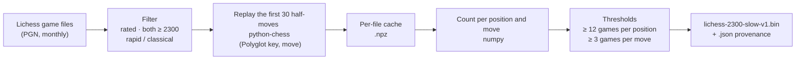

<!-- Generated by scripts/export-docs.mjs from the author's private notes (scripts/book/book.md). Do not edit by hand. -->

> Code references: files in `app/scripts/book/` and `app/src/book/`, part of the git repository https://github.com/jlcuadros/maia-stockfish-analysis (branch `main`).

| Field            | Value |
| ---------------- | ----- |
| **Reported**     | 2026-10-26, part of the author's project notes (José's "iteración 6") |
| **Investigated** | 2026-10-26 |
| **Status**       | ✅ Book built and in the app: `public/book/lichess-2300-slow-v1.bin` (5.49 MB) |
| **Owner**        | José Luis Cuadros |
| **Environment**  | Python 3.9.6 (macOS Command Line Tools) in a virtual environment with `chess` 1.11.2 and `numpy` 2.0.2 (`requirements.txt`); macOS 26, 6 cores, 8 GB RAM |
| **related**      | the author's project notes › Investigation 12 — Opening book (2026-10-26) · app · scripts |

## Abstract
How the app's opening book was made: a Polyglot `.bin` built from **human games played on Lichess**, where **both players are rated 2300 or more** and the time control is **rapid or classical** (no bullet, no blitz). It is used to show, at the start of the explanatory text, the moves strong humans play in the position and how often, and to mark book moves with 📖.

## Summary
- **Games:** 1,127,240 (1,087,764 rapid + 39,476 classical) out of 26,358,132 read, from 66 monthly files of Lichess games (June 2020 – November 2025).
- **Book:** 147,868 positions, 343,239 moves, **5,491,824 bytes** (`sha256 e997e94b…81a4`).
- **Licence:** the Lichess game database is CC0 (public domain), and so is this book.
- **Rebuild:** one command (below), ~13 min the first time on this Mac (6 cores), seconds when only the thresholds change.



## Scope
- **In:** choosing the games, building the book, checking it, documenting how to rebuild it.
- **Out:** how the app shows it (see app: `src/book/`, `src/ui/render.ts`).

## Takeaways
- A statistics book needs a **minimum number of games per position**: below it the "percentages" are anecdotes. Where popular theory ends, the book simply ends.
- The amount of slow games between players rated 2300+ is limited (~1.1 M in 5½ years): with 25 games per position the book was 3.4 MB; **12** gives the requested 5–8 MB.
- The book is checked with an **independent reader** (python-chess) and against the **reference keys of the Polyglot specification** (unit tests of the app's reader).

## related structure
| File | What it is |
| ---- | ---------- |
| [build_book.py](../scripts/book/build_book.py) | The builder: filter, replay, count, thresholds, Polyglot writer, provenance JSON. Commented in detail |
| [gen_polyglot_random.py](../scripts/book/gen_polyglot_random.py) | Writes `src/book/polyglotRandom.ts` (the 781 Polyglot Random64 numbers, from python-chess) so the app computes the same keys |
| [requirements.txt](../scripts/book/requirements.txt) | Python packages with exact versions |
| `public/book/lichess-2300-slow-v1.bin` / `.json` | The book and how it was built (filter, parameters, totals, the month and SHA-256 of every input file, tool versions) |
| `src/book/polyglot.ts` | The app's reader: Polyglot key of a FEN, move decoding (castling), binary search |
| `src/book/openingBook.ts` | Loads the book once and keeps it in IndexedDB |

## Facts
- **Game filter** (`accepted()`): `Event` contains "Rated"; standard chess; no `FEN` header (starts from the initial position); `min(WhiteElo, BlackElo) ≥ 2300`; Lichess's speed rule `base + 40 × increment ≥ 480 s` (rapid ≥ 8 min, classical ≥ 25 min; bullet < 3 min and blitz < 8 min excluded).
- **Book rules:** first **30 half-moves** of each game; a position enters the book if **≥ 12 games** reached it; a move enters if **≥ 3 games** played it; no quality filter (the app's Stockfish colours show quality).
- **Polyglot entries:** key = python-chess `zobrist_hash` (the Polyglot key); move = Polyglot encoding (castling as king-takes-rook); **weight** = the move's share of the position's games scaled to 1..65535; **learn** = number of games that played the move (the app shows the percentages and the total from it).
- **Size by minimum games per position** (same 1.13 M games, max. 30 half-moves, ≥ 3 per move): 25 → 3.37 MB · 20 → 3.92 · 15 → 4.75 · **12 → 5.49** · 10 → 6.17 MB.
- **Resources** (first full run): 785 s with 5 workers; peak memory 1.8 GB; per-file cache 33.4 M (position, move) observations.
- **Checks:** python-chess's reader on the final book — start: e4 52 %, d4 31 %, Nf3 7 %, c4 6 % (1,126,919 games); Najdorf after 5…a6: Be3 40 %, Bg5 21 %; closed Ruy Lopez after 9…O-O: h3 83 %. The app's TypeScript reader gives the same moves and counts (castling decoded as e1g1). Unit tests: the 9 reference keys of the Polyglot specification.

## Notes
**How to rebuild** (from `app/`):
```bash
python3 -m venv .venv-book
.venv-book/bin/pip install -r scripts/book/requirements.txt
.venv-book/bin/python scripts/book/build_book.py \
    --cache /tmp/book-cache \
    --out public/book/lichess-2300-slow-v1.bin \
    <lichess game files: .pgn or .zip with one .pgn>
```
- Options: `--min-elo` (2300), `--max-ply` (30), `--min-position-games` (12), `--min-move-games` (3), `--jobs`.
- Changing only `--min-position-games` / `--min-move-games` reuses the cache: seconds. Changing `--min-elo` / `--max-ply` re-reads the files (the cache name includes them).
- A new book must get a **new file name** (`…-v2.bin`) and `BOOK_FILE` in `src/book/openingBook.ts` updated: the app caches the book by URL.
- `gen_polyglot_random.py` only needs to run again if `polyglotRandom.ts` is lost (the numbers are fixed by the format).

**Input files used:** 66 monthly PGN files of Lichess rated games (June 2020 – November 2025), a public selection of the Lichess database already limited to strong players and without bullet; this script applies the rest of the filter. Their months and SHA-256 are in the `.json`.

## Decision
- **Our own book instead of an existing one** (José, 2026-10-26): the books found were either engine books without a licence (e.g. Human.bin, 14.7 MB), or Lichess-human books only up to 2100 rapid. Ours: humans, 2300+, slow games, CC0 → the author's project notes › Investigation 12 — Opening book (2026-10-26).
- **Values** agreed with José: 3 games per move, 30 half-moves, show the number of games; games per position **25, lowered to 12** to reach 5–8 MB (above the floor of 10 discussed).
- **Own builder** rather than an existing one: lighter on memory (compact numpy arrays: 1.8 GB peak vs ~7 GB reported by a public builder for a similar book) and it stores the game counts in `learn`.

## Next steps
- Optional: a bigger or more recent book (more months, or a "v2") following the steps above.

## History
- 2026-10-26: First build with 25 games per position → 3.37 MB, below the requested 5–8 MB; rebuilt with 12 → 5.49 MB.

## Investigations
_None (the research is in the author's project notes › Investigation 12 — Opening book (2026-10-26))._
